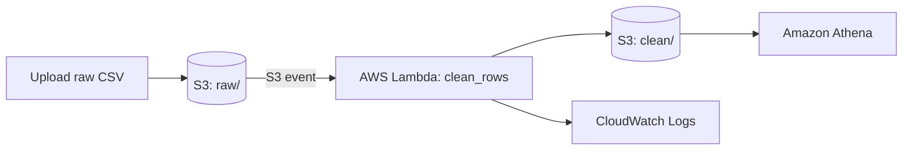

# AWS Serverless Data Pipeline

A fully **serverless** pipeline on AWS: upload a raw CSV to **S3**, a **Lambda** function cleans it automatically, and **Athena** lets you query the clean data with SQL. No servers to manage.

## Architecture


## What the Lambda Does
- Removes duplicate orders
- Validates dates, quantity and price; skips bad rows
- Standardises names and city text
- Calculates `total_amount`
- Writes a clean CSV to `clean/` and logs stats (input / duplicates / invalid)

The cleaning logic lives in a pure function (`clean_rows`) so it can be unit-tested without AWS.

## Tech Stack
AWS S3 · AWS Lambda · Amazon Athena · IAM · CloudWatch · Python (boto3) · SQL

## Setup (AWS Free Tier)
1. **S3:** create a bucket, e.g. `manish-sales-pipeline`, with folders `raw/` and `clean/`.
2. **IAM:** create a Lambda role with `AWSLambdaBasicExecutionRole` plus read/write access to your bucket.
3. **Lambda:** create `sales-clean-handler` (Python 3.12), paste `lambda/handler.py`, and attach the role. Set timeout to 30 s.
4. **Trigger:** add an S3 trigger on `raw/` for `.csv` files (see `s3-trigger-notification.json`).
5. **Test:** upload `sample_data/raw_sales.csv` to `raw/`. A cleaned file appears in `clean/`.
6. **Athena:** set a query result location, run `athena/create_table.sql` (replace the bucket name), then run `athena/queries.sql`.

## Run the Unit Test Locally
```bash
pip install -r requirements.txt
cd lambda && pytest -q
```

## Key Learnings
- Event-driven architecture with S3 triggers
- IAM least-privilege roles
- Querying S3 data directly with Athena external tables

## Future Improvements
- Convert output to Parquet and partition by date for cheaper Athena scans
- Add an AWS Glue crawler to detect schemas automatically
- Provision everything with Terraform or CloudFormation
- Add alerting via SNS on failed files
