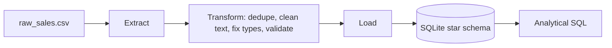
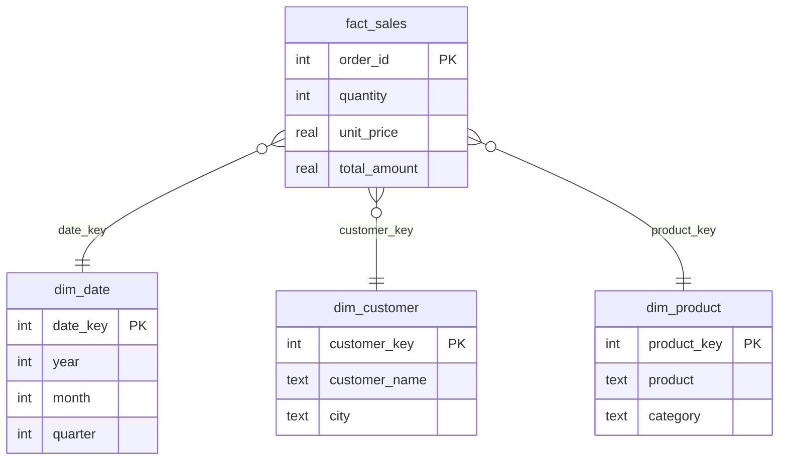

# Sales ETL & Data Warehouse

An end-to-end **ETL pipeline** in Python that cleans messy sales data and loads it into a **star-schema data warehouse**, then answers business questions with analytical SQL (joins, CTEs, window functions).

## Problem
Raw sales exports are rarely clean. This project simulates a realistic file with duplicates, missing values, inconsistent text, impossible dates and negative quantities, and builds a repeatable pipeline to turn it into analytics-ready tables.

## Architecture


## Star Schema


## Data Cleaning Rules
| Issue | Fix |
|---|---|
| Duplicate orders | Drop by `order_id` |
| Extra spaces / mixed case in names and cities | `strip()` + title case |
| Missing city | Fill with `Unknown` |
| Missing unit price | Fill with median price of the same product |
| Impossible dates (e.g. 31/02/2025) | Rows dropped and logged |
| Zero / negative quantity | Rows dropped and logged |

Sample run: **1,540 raw rows → 1,472 clean rows**, loaded into 4 tables.

## Tech Stack
Python · Pandas · SQL · SQLite · Pytest · Logging

## How to Run
```bash
git clone https://github.com/map1199/sales-etl-data-warehouse.git
cd sales-etl-data-warehouse
pip install -r requirements.txt

cd src
python generate_data.py     # creates data/raw_sales.csv
python etl.py               # builds data/warehouse.db
python run_analytics.py     # prints business insights
pytest -q                   # data-quality tests
```

## Analytics Included (`sql/analytics.sql`)
1. Monthly revenue
2. Revenue by product category
3. Top 5 cities by revenue
4. Top 10 customers using `RANK()` window function
5. Month-over-month growth using a CTE and `LAG()`

## Key Learnings
- Designing a star schema (facts vs dimensions) and surrogate keys
- Writing a modular Extract → Transform → Load pipeline with logging
- Validating data quality with automated tests

## Future Improvements
- Switch the warehouse to PostgreSQL
- Schedule the pipeline with Apache Airflow
- Add incremental loads instead of full refresh
